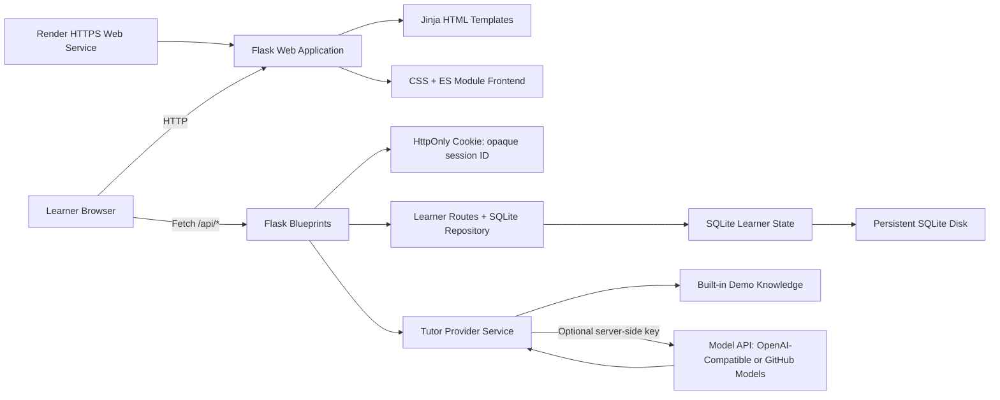

# PM Mentor Architecture

## Component responsibilities

- **Learner Browser:** Chat UI, learning modes, profile controls, and progress presentation.
- **Flask Web Application:** Serves templates and static assets and exposes JSON APIs.
- **Frontend modules:** `static/js/` separates API calls, chat behavior, profile and progress UI, modes, and shared state.
- **Backend packages:** `backend/routes/` handles HTTP; `backend/services/` handles tutor responses; `backend/database.py` handles persistence; `backend/content.py` holds learning content.
- **Session cookie:** Holds only an opaque signed learner-session ID. It is HttpOnly, SameSite=Lax, and Secure in production.
- **SQLite store:** Keeps learner profile, active question, and progress on the server; model credentials are never stored in learner records.
- **Tutor Logic:** Generates questions, evaluates answers, and summarizes strengths and weaknesses.
- **Demo Knowledge:** Provides useful responses when no external AI credential is configured.
- **AI Provider:** Optional OpenAI-compatible chat completion service configured only on the server.
