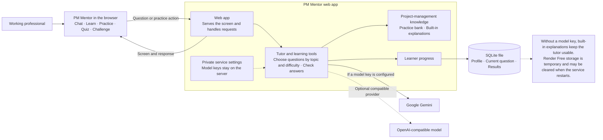
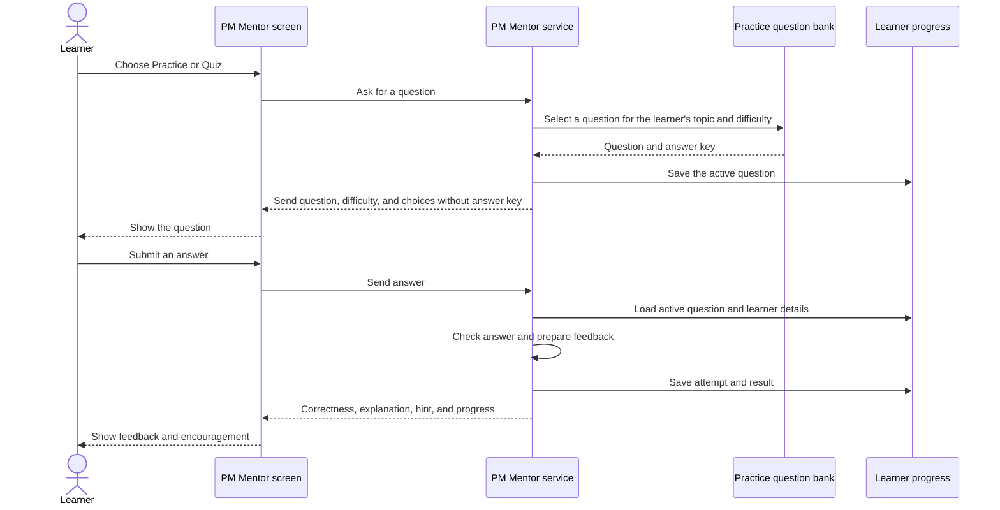
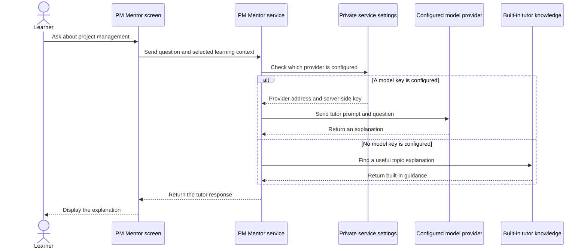

# PM Mentor architecture

PM Mentor is designed around a simple learner journey: ask a question, practice a skill, get feedback, and see what to work on next.

## System architecture

The browser handles the interface. The Flask app handles requests and keeps model credentials out of browser code. Practice questions come from the authored question bank and match the learner's selected topic and difficulty; model calls are used for tutor chat when a provider is configured.

### Where to find the code

| Area | What it does |
|---|---|
| `app.py` | Small local development entry point |
| `pm_mentor/application.py` | Creates the Flask app and connects its routes |
| `pm_mentor/routes/` | Page, health, learner, and tutor endpoints |
| `pm_mentor/services/tutor.py` | Model-provider requests and built-in tutor responses |
| `pm_mentor/learner_repository.py` | Saves and loads learner progress |
| `pm_mentor/learning_content.py` | Practice questions, topics, and built-in explanations |
| `pm_mentor/serve.py` | Production Waitress entry point |
| `static/js/` | Browser API client and learner-facing features |

Learner progress can also be downloaded as a text report from `GET /api/progress/report`.

## Practice question and answer evaluation

## Tutor chat with optional model provider

`GEMINI_API_KEY` is read by the server and is never sent to the browser. The app can also use an OpenAI-compatible provider through its server-side environment settings. Practice questions are served by the authored bank and are not generated by a model.
