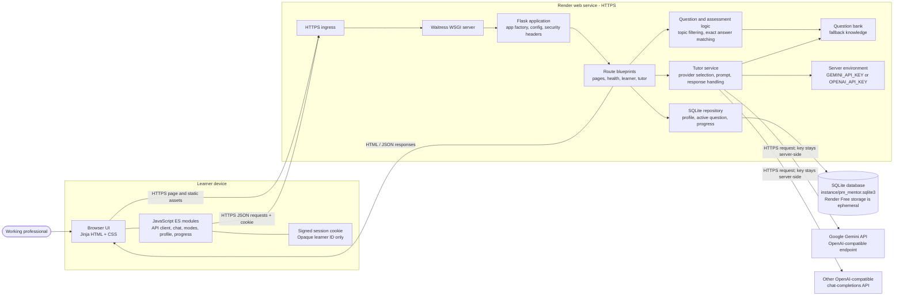
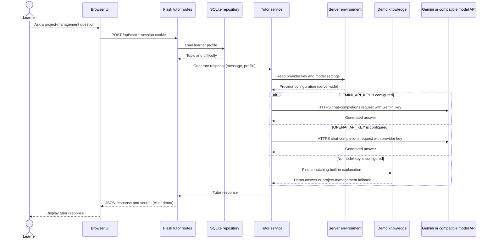

# PM Mentor Architecture

PM Mentor is a small web application for project-management learning. The browser owns presentation and interaction; Flask owns validation, learner state, assessment, and optional model calls.

## System architecture



### Component responsibilities

| Component | Responsibility |
|---|---|
| Browser UI | Displays lessons, chat, practice questions, feedback, and learner progress. |
| Frontend ES modules | `static/js/` separates API calls, chat, modes, profile, progress, state, and DOM helpers. |
| Flask routes | `backend/routes/` serves pages and handles learner, tutor, and health requests. |
| Question and assessment logic | Selects a question for the learner's topic and evaluates submitted answers without sending answer keys to the browser. |
| Tutor service | Uses a configured model provider, or falls back to local demo knowledge when no key is configured. |
| SQLite repository | Stores the profile, active question, and progress by opaque learner ID. |
| Model provider | Optional Gemini or OpenAI-compatible API, called only from the backend using a server environment key. |

### Security and deployment boundaries

- The browser communicates with the app over HTTPS. Its signed, `HttpOnly`, `SameSite=Lax` session cookie contains only an opaque learner ID.
- API credentials are read from the server environment and are never returned by `/api/status`, placed in learner records, or sent to browser JavaScript.
- The default provider is Google Gemini when `GEMINI_API_KEY` is configured; otherwise `OPENAI_API_KEY` enables an OpenAI-compatible provider. Without either key, chat uses built-in demo knowledge.
- `instance/pm_mentor.sqlite3` persists locally. Render Free uses ephemeral filesystem storage, so learner progress can be lost when the service restarts or redeploys.
- Gemini free-tier use is limited and may allow prompts to be used to improve Google's products. Avoid sensitive or confidential input.

## Interaction sequences

### Practice question and answer evaluation

```mermaid
sequenceDiagram
    actor Learner
    participant UI as Browser UI
    participant API as Flask learner routes
    participant Logic as Question and assessment logic
    participant Repo as SQLite repository
    participant DB as SQLite database
    participant Bank as Question bank

    Learner->>UI: Choose Practice
    UI->>API: GET /api/question + session cookie
    API->>Repo: Load learner state
    Repo->>DB: Read profile, progress, active question
    DB-->>Repo: Learner state
    Repo-->>API: Profile and progress
    API->>Logic: Select question for profile topic
    Logic->>Bank: Filter questions by topic
    Bank-->>Logic: Candidate questions
    Logic-->>API: Selected question
    API->>Repo: Save active question
    Repo->>DB: Update learner session
    API-->>UI: Question, choices, and hint (no answer key)
    UI-->>Learner: Display practice question

    Learner->>UI: Submit answer
    UI->>API: POST /api/evaluate
    API->>Repo: Load active question and progress
    Repo->>DB: Read learner state
    DB-->>Repo: Active question and progress
    Repo-->>API: Evaluation state
    API->>Logic: Normalize and compare answer
    Logic-->>API: Correct/incorrect and feedback
    API->>Repo: Update score; clear active question
    Repo->>DB: Save profile, progress, and question state
    API-->>UI: Result, explanation, hint, and progress
    UI-->>Learner: Show feedback and next step
```

### Tutor chat with optional model provider



## Code map

| Path | Role |
|---|---|
| `app.py` | Flask app factory, configuration, security headers, and blueprint registration |
| `backend/routes/` | Page, health, learner, and tutor HTTP endpoints |
| `backend/services/tutor.py` | Model-provider selection, safe model calls, and demo response generation |
| `backend/database.py` | SQLite connection lifecycle and learner-state persistence |
| `backend/content.py` | Topics, practice questions, and demo knowledge |
| `templates/index.html` | Main accessible HTML interface |
| `static/js/` | Frontend ES modules |
| `static/styles.css` | Responsive visual styles |

The [architecture SVG](architecture.svg) provides a standalone visual overview. The diagrams above are Mermaid source and render in GitHub and compatible Markdown previews.
