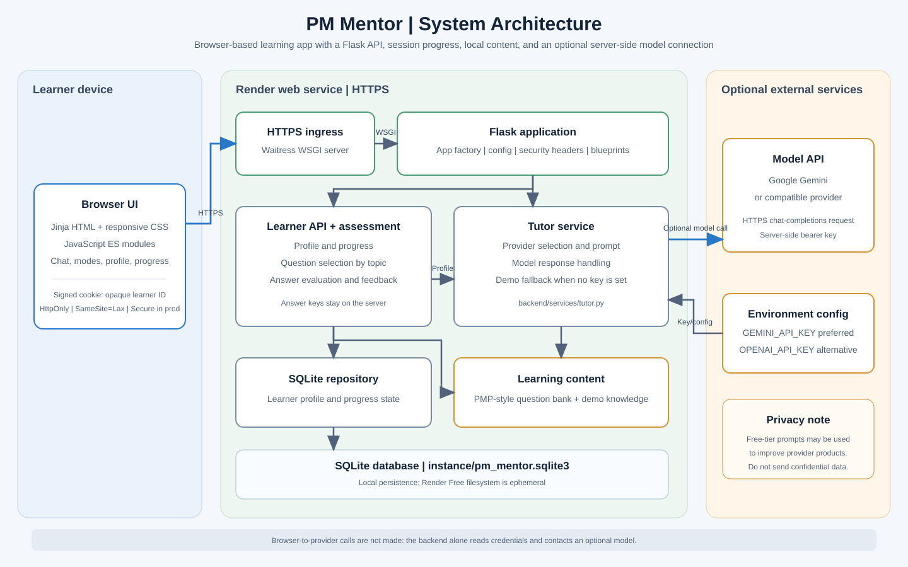
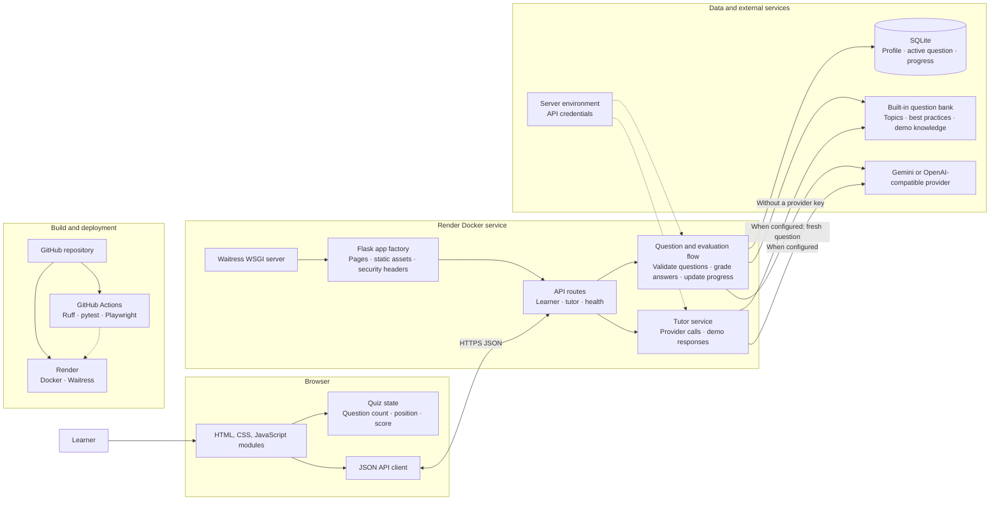
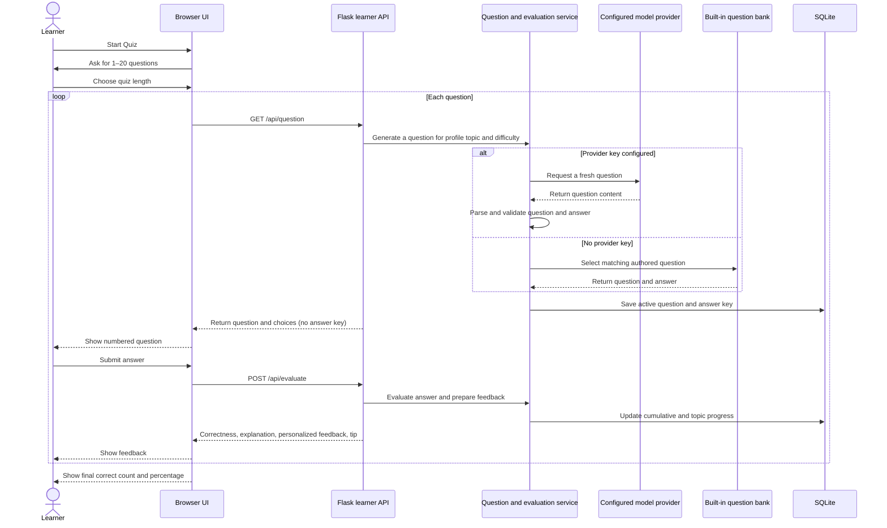
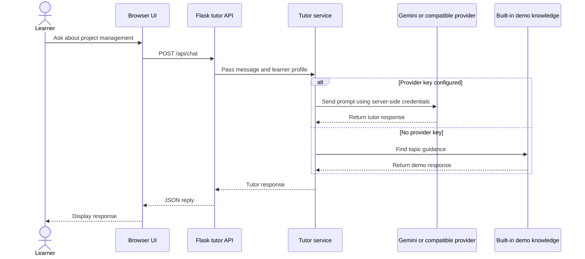

# PM Mentor technical architecture

PM Mentor is a browser-based learning application backed by a Flask service. The browser manages the interactive quiz flow; the server protects provider credentials, generates questions, evaluates answers, and persists learner progress.

## System architecture

### Component responsibilities

| Component | Responsibility |
|---|---|
| Browser UI (`templates/`, `static/js/`) | Renders the tutor, profile, learning modes, feedback, and progress. Quiz count, current position, and in-progress score live in browser memory. |
| Flask application (`pm_mentor/application.py`) | Serves pages and static files, initializes persistence, registers API routes, and applies security settings. |
| Learner routes (`pm_mentor/routes/learner.py`) | Handles profiles, question requests, answer evaluation, progress, report download, and reset. |
| Tutor routes (`pm_mentor/routes/tutor.py`) | Handles tutor chat and public provider status. |
| Tutor service (`pm_mentor/services/tutor.py`) | Calls configured model providers, parses and validates generated questions, and supplies demo responses when no key is configured. |
| SQLite repository (`pm_mentor/learner_repository.py`) | Stores the learner profile, active question and cumulative progress by signed session identifier. |
| Learning content (`pm_mentor/learning_content.py`) | Supplies the no-key question bank, topic content, and best-practice guidance. |
| Render service | Runs the Dockerized Flask application with Waitress. Render Free local storage may be ephemeral. |
| GitHub Actions | Runs Ruff and the API/browser test suite on pushes. |

### API surface

| Endpoint | Purpose |
|---|---|
| `GET /healthz` | Service health check |
| `GET /api/status` | Public model-provider configuration status; never returns credentials |
| `GET` / `POST /api/profile` | Read or update the learner profile |
| `GET /api/question` | Generate a fresh model question when configured, otherwise select from the built-in bank |
| `POST /api/evaluate` | Grade the active question, save progress, and return feedback |
| `GET /api/progress` | Read cumulative learner progress |
| `GET /api/progress/report` | Download a text progress report |
| `POST /api/reset` | Reset cumulative progress and the active question |
| `POST /api/chat` | Send a tutoring request to the configured provider or built-in demo tutor |

## Quiz and answer flow

The quiz's requested length and running score are held in browser memory, while the active answer key and cumulative learning progress remain on the server. Reloading the page does not resume an in-progress quiz.

When a provider is configured, every `/api/question` request asks the model for a new question. The server validates the response before exposing the choices; the answer key remains server-side. Invalid model output is returned as an error rather than silently replaced with a bank question. Without a provider key, question requests use the topic- and difficulty-matched bank.

## Tutor chat flow

Provider credentials are read from server environment variables and are never sent to the browser. The service supports Google Gemini and OpenAI-compatible chat-completion endpoints.
